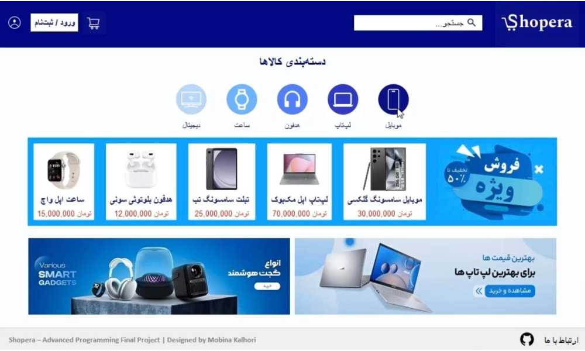
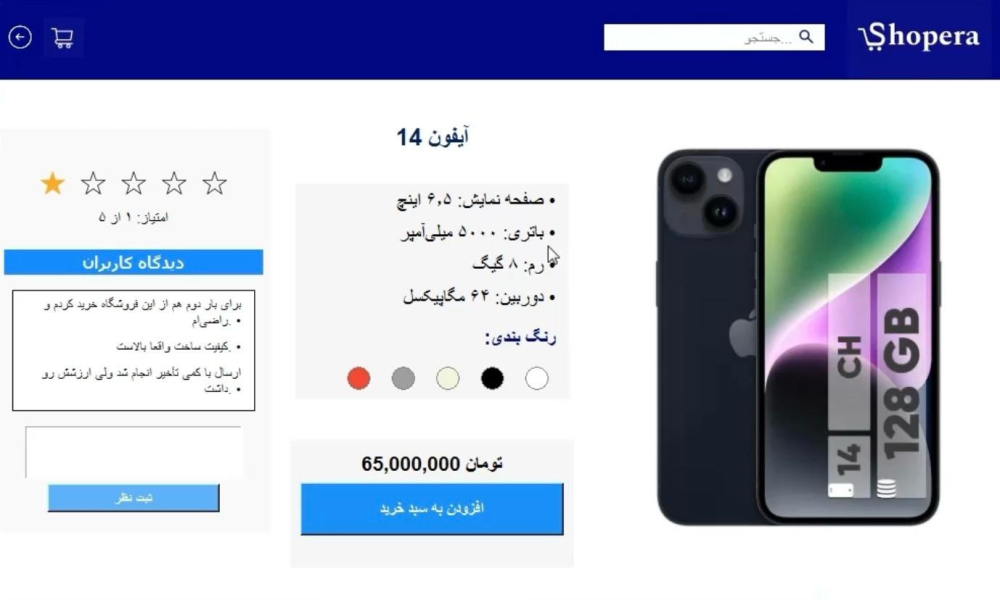
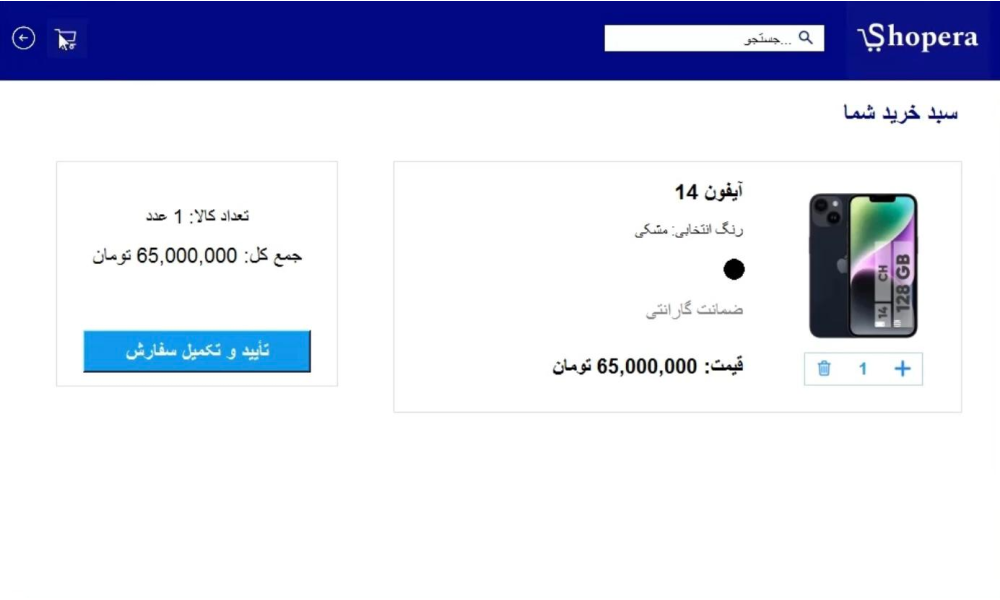
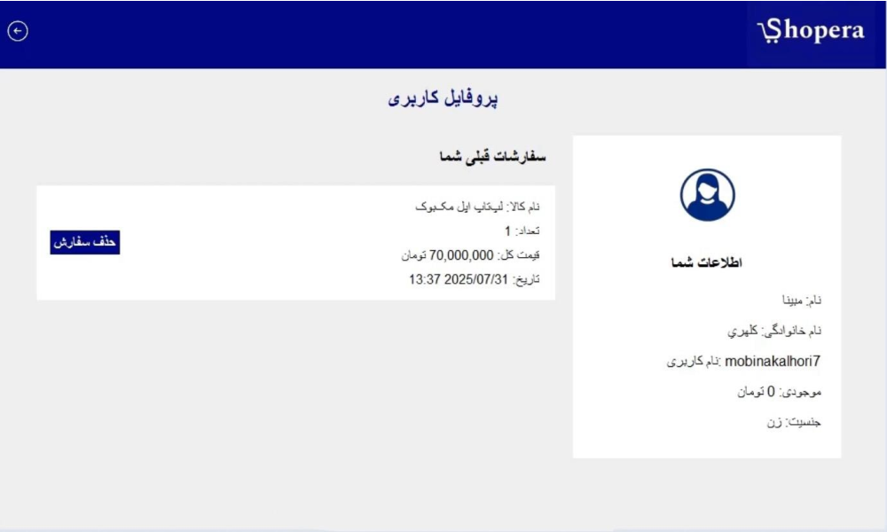
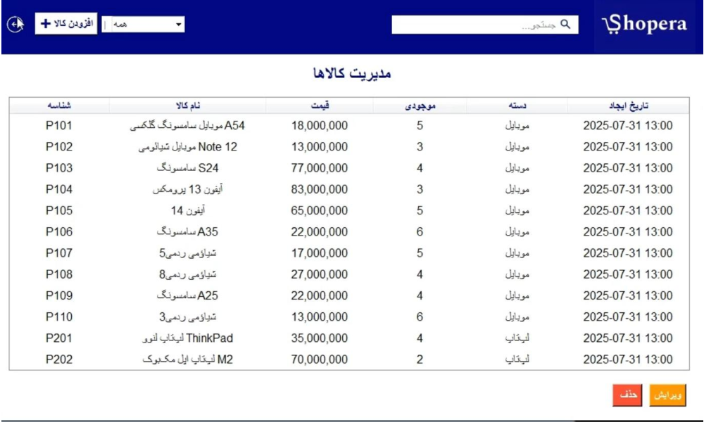

# Shopera - فروشگاه آنلاین

پروژه دوره پایتون مقدماتی - فروشگاه آنلاین کالای دیجیتال با tkinter

---

## فهرست مطالب

## فهرست مطالب

- [معرفی پروژه](#معرفی-پروژه)
- [ویژگی‌های اصلی](#ویژگی‌های-اصلی)
- [ساختار پروژه](#ساختار-پروژه)
- [مدیریت کاربران](#مدیریت-کاربران)
- [سبد خرید و تخفیف](#سبد-خرید-و-تخفیف)
- [نمونه‌های تصویری](#نمونه‌های-تصویری)
- [توسعه‌دهنده](#توسعه‌دهنده)

---

## معرفی پروژه

پروژه با موضوع فروشگاه دیجیتال با دقت بر جزییات و توجه به رابط کاربری مناسب

---

## ویژگی‌ های اصلی

- کاربر می ‌تونه محصولات رو ببینه، جستجو کنه و به سبد خرید اضافه کنه.
- سبد خرید امکان افزایش، کاهش و حذف آیتم رو داره.
- ۵ کالا توی نوار تخفیف نمایش داده می‌ شن و توی سبد خرید قیمت اصلی و تخفیف خورده هر دو نشون داده می‌ شه.
- کاربر می ‌تونه ثبت‌نام کنه و وارد بشه.
- رمز عبور باید حداقل ۶ کاراکتر باشه و شامل عدد و حروف انگلیسی باشه.
- اگر کاربر ادمین باشه، می‌تونه وارد داشبورد مدیریت که شامل پنل مدیریت و گزارش کالا ها و سفارشات هست بشه.
- توی پنل مدیریت می‌تونه محصولات رو اضافه، ویرایش یا حذف کنه.
- کاربر می‌ تونه توی صفحه محصول نظر بده و کامنت‌ها نمایش داده می‌ شن همچنین امتیاز کالا رو به شکل ستاره مشاهده می کنه و میتونه امتیاز ثبت کنه.
- جستجو بر اساس نام محصول یا دسته‌بندی کار می‌کنه.
- سفارشات کاربران در یه فایل جدا ذخیره می ‌شن و به مدیر نمایش داده میشه.
- پروفایل کاربر شامل اطلاعات شخصی که جنسیت کاربر ذخیره شده و ایکون هم تغییر می کند و سفارشات قبلی هست و می‌تونه سفارشات قبلی رو حذف کنه.

---

## ساختار پروژه

فایل‌های اصلی:
- `Shopera.py`: فایل اصلی برنامه
- `users.csv`: اطلاعات کاربران
- `products.csv`: لیست محصولات
- `orders.csv`: سفارشات ثبت‌ شده
- `comments.csv`: کامنت‌ های کاربران

## پوشه ها
- `product_pics/`: تصاویر محصولات
- `details/`: تصاویر جزئیات
- `sabad/`: آیکون‌های سبد خرید
- `stars/`: آیکون‌های امتیاز
- تصاویر دیگه مثل `shopera_nav_logo.png`، `backright.png`، `cart_icon.png` و ...

---

## دسترسی کاربران
کاربران عادی می‌تونن خرید کنن، کامنت بذارن و پروفایل داشته باشن و صفحه پروفایل شخصی سازی شده و آیکون پروفایل کاربر طبق جنسیت تغییر می کند و قابلیت حذف و کنسل کردن سفارشات قبلی وجود دارد.
کاربری که با نام کاربری admin وارد بشه، به پنل مدیریت و گزارش فروش و سفارشات دسترسی پیدا می‌ کنه.
بعد از ثبت‌نام، کاربر خودکار وارد می‌ شه.

---

## سبد خرید و تخفیف
وقتی کاربر محصولی رو به سبد اضافه می ‌کنه، رنگش رو انتخاب می‌ کنه.
توی سبد خرید، برای ۵ کالای تخفیفی، قیمت اصلی با خط  خورده و قیمت تخفیف‌ خورده با رنگ قرمز نشون داده می‌ شه.
جمع کل همیشه با رنگ مشکی و با قیمت نهایی محاسبه می‌ شه.
کاربر می‌ تونه تعداد رو تغییر بده یا کالا رو حذف کنه.

---

## نمونه‌های تصویری

| صفحه اصلی | صفحه محصول | سبد خرید |
|----------|------------|----------|
|  |  |  |

| پروفایل کاربر | پنل مدیریت |
|--------------|-------------|
|  |  |

---

## توسعه دهنده

طراحی شده توسط : مبینا کلهری
مجتمع فنی تهران
